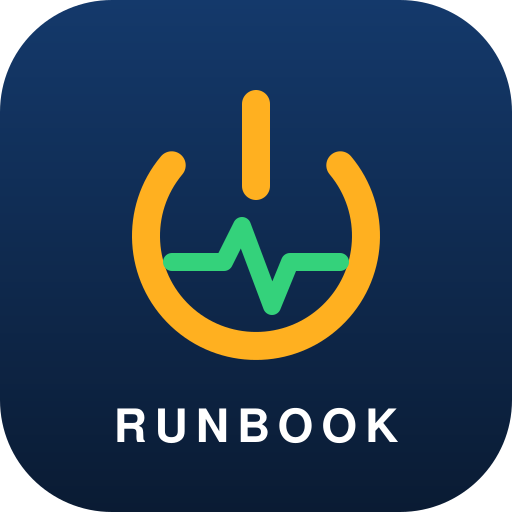

# University Enrollment System: Production Outage Recovery Runbook

> *A simulated scenario:* when a university enrollment system goes down at 2 AM and the senior admin can't be reached, this runbook gets it back up safely. It's written so a junior IT engineer can follow it from first alert to closing the incident.

> 🚫 **Simulated scenario / unofficial project.** This is a simulated exercise. It is not affiliated with, sponsored by, or endorsed by PHINMA Education or any real institution. See the [Disclaimer](#disclaimer).

## 📥 Download

| Option | Link |
| --- | --- |
| **Read in the repo** | [`runbook.pdf`](https://github.com/fpaulpalis/outage/blob/main/runbook.pdf) |
| **Download a release** | [Releases](https://github.com/fpaulpalis/outage/releases) |

## 📖 What's Inside (18 pages)

- **Incident declaration:** how to declare a SEV-1, who takes which role, and who to escalate to
- **Troubleshooting, outside in:** DNS → network → server → app → database → logs → recent changes
- **Recovery actions:** what to do, a "do not do" list, and steps for database restore and failover
- **Verification:** recovery checks, a 45-minute monitoring window, and message templates for stakeholders
- **Worked example:** a 2:00 AM scenario with its timeline and post-incident review
- **Quick Card (p. 17):** a one-page summary to print and keep at the desk

## 🚦 How to Use

1. Open the PDF the moment a SEV-1 alert fires.
2. Declare the incident and assign roles (see the incident declaration section).
3. Work the troubleshooting checklist from the outside in.
4. Apply recovery actions, and check the "do not do" list before touching anything.
5. Run the recovery checks, then watch the system for 45 minutes.
6. Send stakeholder updates using the provided templates.
7. Close the incident and complete the post-incident review.

> 💡 **Tip:** Print the Quick Card (page 17) and keep it at your desk.

## ⚠️ Before You Use This

The values shown in **blue** are **examples only**. Replace them with your real production details (hosts, contacts, credentials locations, escalation paths) **before** relying on this runbook in a live incident.

## 📄 Document Info

| | |
| --- | --- |
| **Title** | University Enrollment System: Production Outage Recovery Runbook |
| **Document ID** | IT-RUNBOOK-001 |
| **Version** | 1.0 |
| **Classification** | Internal Use |
| **Audience** | Junior IT engineers, on-call staff |

## Disclaimer

**Simulated scenario.** This runbook is a fictional, simulated exercise. The outage, the incident, and the response described in it did not actually happen, and the system it describes is not a real production environment.

**Not affiliated or endorsed.** This project is an independent work. It is **not affiliated with, authorized by, sponsored by, or endorsed by PHINMA Education or any real institution, or by any of their officers, employees, or related entities.** The views and content here do not represent the official position of any of them.

**Names and marks.** "PHINMA Education" and any other real names, logos, and trademarks belong to their respective owners. They are used only where referenced, and no ownership or endorsement is claimed or implied.

**Simulated content only.** The system details, hostnames, IP addresses, phone numbers, email addresses, names, roles, dates, and incident timeline in this runbook are **sample values** created for demonstration and learning. They do not describe any real production environment or real people's actual roles, and no real credentials are included.

**No warranty.** This document is provided "as is," without warranty of any kind, express or implied. The authors are not liable for any damage, data loss, downtime, or other consequences arising from its use. Always review and adapt the procedures to your own environment, and have them approved by qualified personnel, before relying on them in a live incident.

**Third-party sources.** Incident-management concepts referenced in the runbook draw on guidance from [incident.io](https://incident.io). That material remains the property of its respective owners.

## 🤝 Contributing

Found something outdated or unclear? Open an [issue](https://github.com/fpaulpalis/outage/issues) or submit a pull request. Please keep the document ID and bump the version number when updating the runbook.
